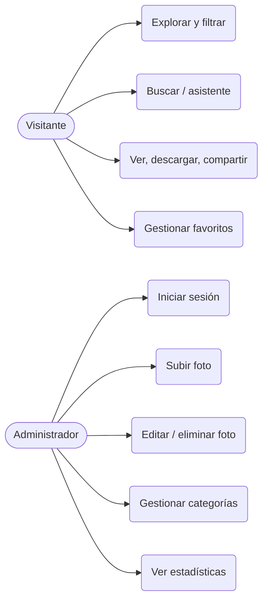
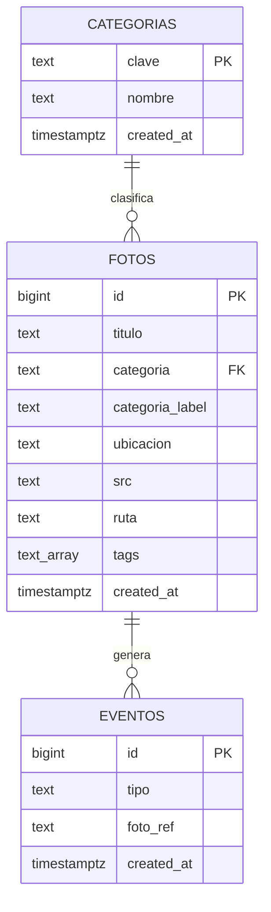
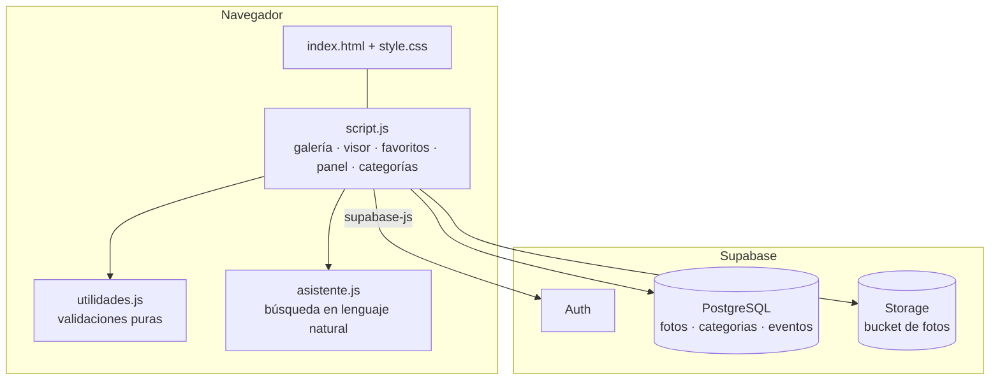
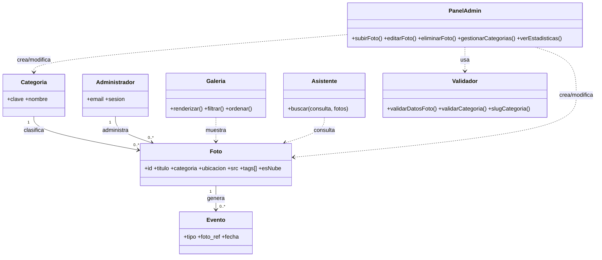

# Galería de Paisajes — Documentación de ingeniería

**Asignatura:** Ingeniería del Software · **Docente:** Kevin Villarreal Jiménez  
**Integrantes:** Jurgen Cantillo, Juan Villegas  
**Repositorio:** https://github.com/juandavidvillegasortega88-droid/mi-galeria  
**Página web:** https://mi-galeria-ci09.onrender.com/  
**Fecha de entrega:** 28 de noviembre de 2026

## 1. Problema, justificación y objetivos

**Problema.** Quien quiere compartir fotografías de paisajes necesita un sitio donde el público las explore y descargue sin crear cuenta, y donde los administradores gestionen el contenido y vean qué gusta más.

**Justificación.** Centralizar la colección en una galería propia, con estadísticas reales de uso, evita depender de redes sociales y permite decidir qué fotos publicar.

**Objetivo general.** Ofrecer una galería web persistente, rápida y fácil de usar, con administración protegida por autenticación.

### Objetivos específicos

1. Permitir explorar, buscar, filtrar, marcar favoritas y descargar fotos.
2. Permitir a los administradores subir, editar y eliminar fotos con datos validados.
3. Permitir a los administradores gestionar las categorías sin tocar el código.
4. Registrar estadísticas anónimas (visitas, vistas, descargas, favoritos, compartidos).
5. Mantener la calidad con pruebas automáticas y documentación al día.

**Alcance:** galería pública y panel para uno o varios administradores, con cuentas creadas manualmente en Supabase (el registro público está desactivado). **Fuera de alcance:** cuentas de visitantes, comentarios y pagos.

**Actores:** *Visitante* (público, sin sesión) y *Administrador* (con sesión en Supabase Auth; todos los administradores tienen los mismos permisos).

## 2. Modelo de proceso

**Incremental.** Se construyó en versiones funcionales: (1) galería estática, (2) nube con Supabase y subida de fotos, (3) estadísticas y panel, (4) asistente de búsqueda, (5) categorías gestionables y validaciones, (6) migración completa a la nube: se eliminan del código las 13 fotos iniciales (datos.js y la carpeta img/) y la galería lee todas las fotos de la base de datos, (7) visor adaptable a la forma de la foto y al dispositivo, y cierre del registro público (solo administradores creados manualmente). Se eligió porque cada incremento ya era utilizable y los requisitos fueron madurando con el uso.

## 3. Requisitos

### 3.1 Requisitos funcionales

| Cód. | Requisito |
|---|---|
| RF01 | Iniciar y cerrar sesión de administrador; el panel solo es visible con sesión. |
| RF02 | Explorar la galería, ordenar, cambiar de vista y filtrar por categoría. |
| RF03 | Buscar fotos por texto y mediante el asistente en lenguaje natural. |
| RF04 | Ver una foto ampliada con zoom, navegar entre fotos, descargar y compartir. El visor se adapta a la forma de la foto y al dispositivo y, en computador con fotos verticales, muestra etiquetas, tamaño real y fotos relacionadas. |
| RF05 | Marcar y desmarcar favoritas (persisten en el navegador) y descargarlas. El contador solo cuenta las favoritas que todavía existen en la galería. |
| RF06 | El administrador sube fotos (se optimizan a máx. 1920 px). |
| RF07 | El administrador edita y elimina las fotos que subió. |
| RF08 | El administrador crea, renombra y elimina categorías. |
| RF09 | Registrar eventos de uso y mostrarlos en el panel (visitas por día, ranking de fotos). |

### 3.2 Requisitos no funcionales

| Tipo | Requisito | Cómo se cumple |
|---|---|---|
| Seguridad | Solo los administradores escriben datos | Supabase Auth y políticas RLS; el registro público está desactivado y las cuentas de administrador se crean manualmente; la interfaz solo oculta botones |
| Usabilidad | Tareas frecuentes sencillas | Filtros por chips, tema claro/oscuro, diseño responsive, visor adaptable, avisos (toasts) y mensaje «Cargando galería...» mientras llegan las fotos |
| Integridad | Datos consistentes | Validaciones (RN01–RN09) y borrado de archivos huérfanos |
| Disponibilidad | Degradar sin errores si falla la nube | Si Supabase no responde, la galería muestra el estado vacío sin romperse y usa las categorías por defecto del código; las fotos dependen de la nube |
| Mantenibilidad | Fácil de modificar | Reglas puras separadas (utilidades.js) y pruebas automáticas |
| Rendimiento | Carga ágil | Imágenes optimizadas, caché larga en Storage, sin frameworks; el código ya no incluye las fotos iniciales (≈3,2 MB menos) |

## 4. Reglas de negocio

| Cód. | Regla |
|---|---|
| RN01 | Solo un administrador autenticado puede subir, editar, eliminar fotos o gestionar categorías. |
| RN02 | El título de una foto tiene entre 3 y 80 caracteres y no puede repetirse. |
| RN03 | Toda foto pertenece a una categoría. |
| RN04 | Máximo 10 etiquetas por foto, de hasta 30 caracteres cada una. |
| RN05 | Una categoría con fotos no se puede eliminar; siempre debe quedar al menos una. |
| RN06 | El nombre de una categoría tiene entre 3 y 30 caracteres y no puede repetirse. |
| RN07 | Las acciones del administrador no se cuentan en las estadísticas. |
| RN08 | Si una foto no se puede registrar en la base de datos, se borra el archivo subido (sin huérfanos). |
| RN09 | No existe el registro público: las cuentas de administrador las crea manualmente el responsable del proyecto en Supabase. |

## 5. Casos de uso

*Figura 1. Diagrama de casos de uso*

**CU-Explorar la galería.** *Actor:* Visitante. *Flujo:* abre la página; el sistema muestra «Cargando galería...», lee la tabla *fotos* de Supabase, pinta las fotos y actualiza los contadores y los chips de categoría. *Alternos:* si no hay fotos o la nube no responde, se muestra el estado vacío («No se encontraron paisajes») sin errores.

**CU-Ver foto ampliada.** *Actor:* Visitante. *Flujo:* hace clic en una foto; el visor mide la foto al cargarla y elige el diseño. En computador con fotos verticales muestra la foto a la izquierda y una columna con título, etiquetas, tamaño real, miniaturas de la misma categoría y los botones; en celular y tablet vertical muestra la foto arriba y una ficha compacta debajo. *Alternos:* las fotos horizontales o cuadradas llevan la ficha debajo; al pulsar una miniatura se abre esa foto.

**CU-Subir foto.** *Actor:* Administrador. *Precondición:* sesión iniciada. *Flujo:* abre «Subir foto», elige la imagen (se optimiza y se muestra una vista previa), completa título, categoría, ubicación y etiquetas; el sistema valida (RN02–RN04), sube el archivo a Storage, inserta la fila en *fotos* y la foto aparece para todos. *Alternos:* datos inválidos, se muestra el primer error y no se sube; falla la inserción, se borra el archivo (RN08).

**CU-Gestionar categorías.** *Actor:* Administrador. *Flujo:* en el panel escribe un nombre, el sistema valida (RN06) y crea la categoría; chips y listas desplegables se actualizan al instante. *Alternos:* renombrar (cambia en todas las fotos sin tocarlas) y eliminar (bloqueado si tiene fotos, RN05).

**CU-Buscar con el asistente.** *Actor:* Visitante. *Flujo:* escribe «quiero una playa al atardecer»; el sistema quita palabras vacías, normaliza tildes y plurales, puntúa título, etiquetas, ubicación y categoría, aplica sinónimos y muestra hasta 4 fotos.

## 6. Modelo de datos (relacional)

*Figura 2. Modelo entidad-relación (Supabase / PostgreSQL)*

Los tipos de evento son: visita, vista, descarga, compartir y favorito. **Todas las fotos viven en la tabla *fotos*** (con su archivo en Storage): el código ya no contiene fotos iniciales, por lo que no existe el archivo datos.js. Los eventos registran el identificador de la foto en *foto_ref*. Los eventos guardados antes de la migración con *foto_ref* «1» a «13» (las antiguas fotos fijas) pueden seguir en la tabla *eventos*; el panel solo muestra el ranking de las fotos que existen hoy.

## 7. Arquitectura y diseño

**Cliente-servidor sin servidor propio (BaaS).** El navegador ejecuta toda la lógica y Supabase aporta base de datos, autenticación, almacenamiento y seguridad por filas (RLS). Se eligió porque el alcance no justifica mantener un backend, reduce costos y la seguridad real queda en la base de datos.

*Figura 3. Arquitectura del sistema*

### Módulos

1. Galería pública (explorar, filtrar, ordenar, vistas)
2. Visor (zoom, navegación, descarga, compartir; diseño adaptable a la foto y al dispositivo)
3. Favoritos
4. Asistente de búsqueda
5. Autenticación del administrador
6. Gestión de fotos (subir, editar, eliminar)
7. Gestión de categorías
8. Estadísticas y panel

### Control de acceso

- **Registro público desactivado:** en Supabase Auth la opción «Allow new users to sign up» está apagada; nadie puede crearse una cuenta con la clave pública del proyecto.
- **Cuentas creadas a mano:** los administradores se crean desde Authentication → Users y todos tienen los mismos permisos.
- **Políticas RLS (diseño):** lectura pública de fotos y categorías; escritura solo con sesión iniciada; los eventos se insertan de forma anónima y solo se leen con sesión.
- **Cuenta de revisión:** la cuenta de prueba entregada al docente se elimina de Supabase al terminar la evaluación.

### Diseño orientado a objetos y responsabilidades

Aunque el código es JavaScript modular (no basado en clases), el modelo de dominio tiene estas entidades y colaboraciones:

*Figura 4. Diagrama de clases (atributos, operaciones, relaciones y multiplicidades)*

### Patrones aplicados

- **Observer:** los eventos del DOM y *onAuthStateChange* notifican cambios a la interfaz (por ejemplo, al iniciar sesión se muestran u ocultan los controles de administrador).
- **Degradación elegante (fallback):** si la tabla de categorías no responde, se usan las categorías por defecto del código; si falla la carga de fotos, la galería muestra el estado vacío y sigue funcionando.
- **Estado de carga:** una bandera (*cargandoNube*) muestra «Cargando galería...» hasta que llegan las fotos, para no mostrar «No se encontraron paisajes» antes de tiempo; al terminar la carga se repinta siempre la galería, los contadores y el panel.
- **Delegación de eventos:** los chips de categoría y las miniaturas del visor se generan dinámicamente y un único listener atiende todos los clics.
- **Diseño adaptable por estado:** el visor mide la foto al cargarla y guarda su forma en un atributo (*data-forma*); el CSS elige el diseño según esa forma y el tamaño de pantalla.

## 8. Pruebas y control de calidad

**Estrategia:** pruebas unitarias automáticas de la lógica pura (*node tests/run.js*) y pruebas manuales de interfaz.

**Resultado automático: 19 de 19 pruebas superadas** (evidencia en *tests/resultados.txt*).

| Id | Prueba automática | Id | Prueba automática |
|---|---|---|---|
| T01 | Busca por etiqueta | T11 | Categoría válida devuelve cadena vacía |
| T02 | Ignora tildes y plurales | T12 | Categoría solo con símbolos es inválida |
| T03 | Usa sinónimos (playa → costa) | T13 | Foto válida no genera errores |
| T04 | Consulta sin palabras útiles → null | T14 | Título corto genera error |
| T05 | Máximo 4 resultados | T15 | Título solo con espacios genera error |
| T06 | Sin coincidencias → lista vacía | T16 | Título muy largo genera error |
| T07 | slug quita tildes y espacios | T17 | Sin categoría genera error |
| T08 | slug con acentos | T18 | Más de 10 etiquetas genera error |
| T09 | Categoría muy corta es inválida | T19 | Título repetido genera error |
| T10 | Categoría duplicada es inválida |  |  |

### Pruebas manuales

| Id | Prueba | Resultado esperado | Resultado real |
|---|---|---|---|
| M01 | Visitante abre la galería sin sesión | Ve fotos; no ve botones de administrador | Por probar |
| M02 | Login con datos incorrectos | Mensaje «Correo o contraseña incorrectos» | Por probar |
| M03 | Subir foto con título de 2 letras | Aviso de validación; no se sube | Cumple: rechazó el título «ab» con aviso |
| M04 | Subir foto válida | Aparece en la galería y en el panel | Cumple: la foto se publicó y se ve en la galería y en el panel |
| M05 | Crear categoría «Desiertos» | Nuevo chip y opción en las listas | Cumple: apareció el chip y la opción en las listas |
| M06 | Eliminar categoría con fotos | Bloqueado con aviso (RN05) | Cumple: bloqueó eliminar «Montañas» |
| M07 | Renombrar categoría | El nombre cambia en todas sus fotos | Por probar |
| M08 | Marcar favorita y recargar | La favorita persiste | Por probar |
| M09 | Buscar «playa» en el asistente | Sugiere fotos relacionadas | Por probar |
| M10 | Tema oscuro y móvil | Interfaz legible y sin desbordes | Cumple: probado en celular y en computador con tema oscuro |
| M11 | Abrir la galería sin fotos en la base o sin conexión a Supabase | Muestra «Cargando galería...» y luego el estado vacío, sin errores en consola | Por probar |
| M12 | Tener en el navegador favoritas de las antiguas fotos fijas (ids 1 a 13) | El contador de favoritas solo cuenta las fotos que existen | Por probar |
| M13 | Abrir una foto vertical en computador y en celular | Computador: foto a la izquierda y columna de información. Celular: foto arriba y ficha compacta. Sin barras negras ni deformación | Celular: cumple. Computador: por probar con la ficha extra |
| M14 | Intentar crear una cuenta nueva con la clave pública | Supabase rechaza el registro; solo entran los usuarios creados manualmente | Por probar |

## 9. Métricas

| Métrica | Valor |
|---|---|
| Líneas de código (HTML / CSS / JS) | 456 / 1 461 / 1 582 (script 1 343 + asistente 205 + utilidades 34) |
| Funciones | 61 en script.js · 4 en asistente.js · 3 en utilidades.js |
| Fotos incluidas en el código | 0 (antes 13; se eliminaron datos.js y la carpeta img/) |
| Pruebas automáticas | 19 (100 % superadas) |
| Módulos funcionales | 8 |
| Requisitos | 9 funcionales · 6 no funcionales · 9 reglas de negocio |
| Dependencias externas | 1 (supabase-js) |

## 10. Riesgos y mitigación

| Riesgo | Mitigación |
|---|---|
| Clave pública expuesta en config.js | Es una clave publishable; la seguridad real son las políticas RLS y el registro público desactivado |
| Políticas RLS mal configuradas | Probar con y sin sesión (M01, M04) y revisar tras cada cambio de tablas |
| Caída de Supabase | Sin la nube no hay fotos: la galería muestra el estado vacío y las categorías por defecto, sin errores (M11). Es un riesgo aceptado al depender de la base de datos para todas las fotos. |
| Pérdida de favoritos | Se guardan en localStorage (por navegador); documentado como limitación. Las favoritas que ya no existen se ignoran en el contador (M12). |
| Eventos antiguos de las fotos fijas | Los eventos con foto_ref «1» a «13» siguen en la tabla eventos; no afectan el panel, y pueden eliminarse con una consulta SQL si se desea limpiar la tabla. |
| Todos los administradores tienen el mismo poder | Pocas cuentas, creadas solo por el responsable del proyecto y con el registro público cerrado. |
| Cuenta de prueba entregada al docente | Se elimina de Supabase (Authentication → Users) al terminar la revisión. |
| Crecimiento de Storage | Optimización a 1920 px / JPEG 86 % y borrado de archivos al eliminar una foto |

## 11. Cambios respecto a las versiones anteriores

### Versión 2: migración a la nube

| Sección | Cambio |
|---|---|
| 2. Modelo de proceso | Nuevo incremento (6): migración completa a la nube. |
| 3. Requisitos | RF05 aclara el contador de favoritas; RNF de usabilidad (mensaje de carga), disponibilidad y rendimiento actualizados. |
| 5. Casos de uso | Nuevo CU-Explorar la galería (carga desde la base de datos y estado vacío). |
| 6. Modelo de datos | Se elimina la referencia a datos.js; todas las fotos están en la tabla fotos. |
| 7. Arquitectura | Figura 3 sin el módulo datos.js; patrón de degradación actualizado y nuevo patrón de estado de carga. |
| 8. Pruebas | Nuevas pruebas manuales M11 y M12. |
| 9. Métricas | Líneas de código y funciones recalculadas; 0 fotos en el código. |
| 10. Riesgos | Riesgo de caída de Supabase reformulado; nuevo riesgo por eventos antiguos. |

### Versión 3: versión final

| Sección | Cambio |
|---|---|
| 1. Alcance y actores | Se pasa de «administrador único» a uno o varios administradores con cuentas creadas manualmente. |
| 2. Modelo de proceso | Nuevo incremento (7): visor adaptable y registro público cerrado. |
| 3. Requisitos | RF04 incluye el visor adaptable; RNF de seguridad y usabilidad actualizados. |
| 4. Reglas de negocio | Nueva RN09: no existe el registro público. |
| 5. Casos de uso | Nuevo CU-Ver foto ampliada. |
| 7. Arquitectura | Nueva sección «Control de acceso»; módulo Visor actualizado y nuevo patrón de diseño adaptable por estado. |
| 8. Pruebas | Nuevas pruebas manuales M13 y M14; se registran los resultados de M03 a M06 y M10. |
| 9. Métricas | Recalculadas con el código final: 456 / 1 461 / 1 582 líneas y 61 funciones en script.js. |
| 10. Riesgos | Nuevos riesgos: poder igual de todos los administradores y cuenta de prueba del docente. |

